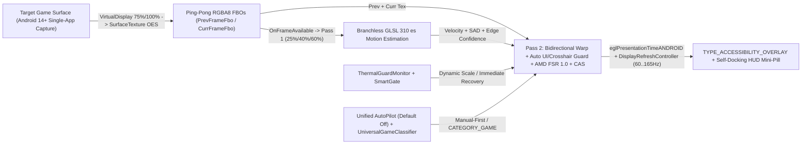

<div align="center">

# Framewise (FrameBoost) v1.0.2

**Real-Time Event-Driven Android GPU Frame Interpolation (30→60 & 60→90/120/144/165+ FPS) + AMD FSR 1.0 & CAS**  
**توليد الإطارات على المعالج الرسومي بالاستجابة الفورية للأحداث (30→60 و 60→90/120/144/165+ إطاراً) مع AMD FSR 1.0 و AMD CAS**

[-00E676?style=for-the-badge&logo=android&logoColor=white)](https://github.com/omarpromax2021do-droid/FrameBoost)
[](https://github.com/omarpromax2021do-droid/FrameBoost)
[](https://github.com/omarpromax2021do-droid/FrameBoost)
[](https://github.com/omarpromax2021do-droid/FrameBoost/releases/latest)

</div>

---

## English Documentation

### What's New in v1.0.2

- **Multi-OEM Booster & Throttler Suppressor (`OemBoosterSuppressor`)**: Automatically detects and suppresses background vendor game daemons across Realme/Oppo/OnePlus (`GameSpace`, `CosA`), Xiaomi/Redmi/POCO (`Joyose`, `PowerKeeper`, `Game Turbo`), Samsung (`GOS`, `Game Booster`, `SDHMS`), Google Pixel (`Game Dashboard`), Motorola/Lenovo (`Game Mode`, `Game Time`), Vivo/iQOO/Transsion/Huawei/Honor/Asus/Nubia, plus heuristic package matching — silently trimmed on launch and every 40s while active.
- **ADPF Kernel-Level Priority (`AdpfSessionManager`) & Edge Gesture Block**: Registers `GLRenderThread` and `FramewiseCaptureThread` (both `THREAD_PRIORITY_URGENT_DISPLAY`) with Android `PerformanceHintManager` (API 31–37+) and locks `ViewCompat.setSystemGestureExclusionRects` along left/right edges so OEM sidebars cannot steal gameplay focus.
- **Zero Toast Spam & Session-Scoped Accessibility**: Eliminated all Auto-Pilot / RAM cleanup / GameMode `Toast` popups. `FrameBoostOverlayService` checks unified `auto_pilot_enabled` (`false` by default) first and deduplicates internal activity transitions per package with a strict 30-minute cooldown.
- **Manual Control First & Universal Game Classifier (`UniversalGameClassifier`)**: Selecting any Mode, Scale, Target FPS, or CAS preset sets `manualOverrideActive = true` so Auto-Pilot never overrides user configuration. When explicitly enabled, classifies all installed `CATEGORY_GAME` titles and custom profiles into `30→60 Console` (`CAS 0.80`) or `60→90/120/144/165+ Competitive`.
- **Event-Driven Zero-Drain GPU Pipeline**: Removed all live-loop `glFinish()` calls (non-blocking 20-frame `GL_EXT_disjoint_timer_query` polling only) and gated Pass 1/Pass 2 + VSync callbacks strictly on captured frame arrivals (zero idle draws/swaps).
- **AMD FSR 1.0 + Safe Normalized 5-Tap CAS**: Captures `25%` / `40%` presets at **75% spatial resolution** (`1800x810` on `2400x1080`, ~44% bandwidth reduction) and upscales to 100% native in Pass 2 fused with 5-tap AMD CAS safely scaled to `0.00–0.35`.
- **Automatic Shader UI/Crosshair Guard & Self-Adapting Floating HUD**: `frame_synthesis_cas.frag` automatically detects static high-contrast UI/crosshairs and clamps `interpolationAlpha = 0.0` alongside manual HUD Zones. The floating HUD auto-clamps inside safe bounds on rotation, auto-collapses into a compact `⚡ Base→Output FPS` micro-pill after 6 seconds, and expands on tap with a **1-Tap Mode Switcher** (`120Hz+ Boost`, `60Hz Smooth`, `FSR + CAS Only`, `Auto`).
- **System Display Refresh Rate Lock (60Hz ↔ 90/120/144/165Hz+)**: Applies `preferredDisplayModeId`, `preferredRefreshRate`, and `Surface.setFrameRate` across both render and touchable HUD windows, with optional `WRITE_SETTINGS` lock across `min_refresh_rate`, `peak_refresh_rate`, `user_refresh_rate`, and `ScreenRefreshRate` (restored cleanly on stop).
- **Unrestricted High-Refresh + Seamless Rotation**: Never downgrades `120Hz+ Competitive` on low battery (shows a bilingual `>20%` battery advisory instead), resizes smoothly across Portrait ↔ Landscape with translucent clear, and clears SmartGate fallback immediately once base FPS recovers.

### How Framewise Works (Event-Driven OpenGL ES 3.1 Pipeline)

Framewise intercepts game frames via `MediaProjection` + `VirtualDisplay` directly into an external OpenGL texture (`GL_TEXTURE_EXTERNAL_OES`) with zero CPU `Bitmap` readback, computes motion vectors only when a new game frame arrives, upscales/sharpens with AMD FSR 1.0 + CAS, and outputs on a touch-passthrough `TYPE_ACCESSIBILITY_OVERLAY` window (`FLAG_NOT_TOUCHABLE`) paired with a dual-window refresh lock.



### Supported Interpolation & Clarity Modes

| Mode | Target Cadence | Spatial / Motion Scale | Best Use Case | SmartGate Min Base FPS |
| :--- | :--- | :--- | :--- | :--- |
| **60→120/144+ FPS Competitive** | Alternates real & synthesized frames on `90/120/144/165Hz` VSync | 40% Balanced (75% Spatial) or 60% Quality (100% Spatial) | **Call of Duty Mobile** & fast shooters on high-Hz panels | 40 FPS |
| **30→60 FPS Console** | Doubles 30 FPS console-paced gameplay to 60Hz | 25% Ultra-Light (75% Spatial, `<1.2ms` GPU) | **Red Dead Redemption 1** & heavy AAA 3D games | 24 FPS |
| **60Hz Stabilizer + CAS** | Event-driven passthrough + FSR 1.0 & 5-tap AMD CAS | Motion Bypassed (`<0.3ms` overhead) | Legacy 60Hz devices, thermal throttling, low base FPS | Always On |

### Auto-Pilot Game Engine, RAM Optimizer & Thermal Guard

- **Manual-First Auto-Pilot**: Disabled (`false`) by default; toggled from either the Home Dashboard or Settings via the shared `auto_pilot_enabled` preference. Manually picking any preset locks `manualOverrideActive = true`.
- **Universal All-Games Coverage**: Supports custom profiles (`CODM`, `PUBG`, `RDR1`, `Genshin`, etc.) plus any installed game flagged with `ApplicationInfo.CATEGORY_GAME` or known game package patterns. Zero popup Toasts ever appear during launch or gameplay.
- **Pre-Launch RAM Booster & `GameManager`**: Trims non-essential background cached processes via `ActivityManager.killBackgroundProcesses`, reports real freed MB in the dashboard, and reads Android `GameManager.getGameMode()` (API 31+).
- **Thermal Guard (API 26–37+)**: Uses `PowerManager.OnThermalStatusChangedListener` (API 29+) + battery temperature BroadcastReceiver (`>= 42°C` on API 26–28) to step down GPU load (`60% → 40% → 25% → CAS-Only`) while keeping AMD CAS sharpening active, restoring automatically on cooldown. Note: Low battery shows an advisory tip (`>20%` recommended) without restricting high-refresh modes.
- **Visual Split-Screen Benchmark**: Side-by-side live OpenGL ES 3.1 top/bottom comparison (Raw Baseline vs Framewise Optical Flow + CAS) with hardware timings and Markdown/JSON report export.

### Device Compatibility Matrix

| Tier | Criteria | Android Support | Recommended Preset |
| :--- | :--- | :--- | :--- |
| **High Flagship** | OpenGL ES 3.1+, 7GB+ RAM, 120–165Hz+ panel, `<1.6ms` calibrated shader | Android 8.0 – Android 17+ (API 26–37+) | `60→120/144+ Competitive`, 60% Quality, CAS `65%` |
| **Mid-Range High-Hz** | OpenGL ES 3.0+, 4–8GB RAM, 90–144Hz panel, `<=4.5ms` pass (e.g. Moto G85 / Adreno 619) | Android 8.0 – Android 17+ (API 26–37+) | `60→120 Competitive` (40% Balanced) or `30→60 Console` (25% RDR1) |
| **Legacy 60Hz** | 60Hz display or `>4.5ms` shader pass | Android 8.0 – Android 17+ (API 26–37+) | `30→60 Console` (25% Ultra-Light) or `60Hz Stabilizer + CAS` |

### Honest Technical Disclaimers

- **Zero Fake Telemetry**: Live FPS, frame time, GPU pass timing (`GL_EXT_disjoint_timer_query` non-blocking 20-frame polling; offline calibration only uses `glFinish()`), latency, thermal status, and freed RAM metrics are strictly measured from live system APIs.
- **Pipeline Latency**: Optical flow stores 1 prior frame in GPU FBOs, adding ~1 frame of capture buffering latency.
- **Input Frame Stability**: Frame generation works cleanly when the base game holds a steady **24–30+ FPS** (for 30→60 Console Mode) or **40–60+ FPS** (for 60→120+ Competitive Mode). Heavy base stuttering cannot be eliminated by post-process interpolation, so **SmartGate** automatically falls back to **CAS-Only** cleanly when base FPS drops and recovers immediately once FPS stabilizes.
- **Pre-Android 14 Note**: Single-App `MediaProjection` capture is supported on Android 14+ (API 34+); older Android versions (8–13) capture the whole display surface, so users should minimize Framewise before launching a game.

### Build & Release Guide

```bash
# 1. Debug APK + Release APK + JVM Unit Tests
./gradlew assembleDebug assembleRelease testDebugUnitTest

# 2. Signed Release APK (configure keystore/frameboost-release.jks in local.properties or env vars)
./gradlew assembleRelease

# 3. SHA-256 verification artifact (used by in-app HTTPS GitHub Updater)
sha256sum FrameBoost-v1.0.2.apk > FrameBoost-v1.0.2.apk.sha256
```

---

## التوثيق باللغة العربية (Arabic Documentation)

<div dir="rtl">

### ما الجديد في الإصدار v1.0.2

- **قمع مسرّعات الأنظمة المتعددة (`OemBoosterSuppressor`)**: رصد وكبح خدمات تقييد الألعاب التلقائية في الخلفية لجميع الشركات (Realme / Oppo / OnePlus `GameSpace` و`CosA`، Xiaomi `Joyose` و`PowerKeeper` و`Game Turbo`، Samsung `GOS` و`Game Booster`، Google Pixel `Game Dashboard`، Motorola / Lenovo، Vivo، Transsion، Asus) بصمت تام عند التشغيل وكل 40 ثانية ليبقى Framewise المتحكم الوحيد في الأداء.
- **أولوية النواة عبر Android ADPF (`AdpfSessionManager`) ومنع أشرطة السحب الجانبية**: ربط خيوط الرسم والالتقاط (`THREAD_PRIORITY_URGENT_DISPLAY`) بـ `PerformanceHintManager` (API 31–37+) مع حجب إيماءات الحواف `ViewCompat.setSystemGestureExclusionRects` لمنع قوائم Game Turbo / Game Space / GOS الجانبية من سحب التركيز أثناء اللعب.
- **إزالة إشعارات Toast ومنع التكرار داخل اللعبة**: حذف جميع رسائل `Toast` الخاصة بالطيار الآلي والذاكرة وGameMode، وفحص تفعيل `Auto-Pilot` الموحد (معطّل افتراضياً للتحكم اليدوي الكامل) وتجاهل انتقالات النوافذ داخل نفس اللعبة مع فترة تبريد 30 دقيقة لكل حزمة.
- **حماية HUD تلقائية في المظلّل + نافذة عائمة ذكية**: يكتشف مظلّل `frame_synthesis_cas.frag` مؤشرات التصويب والنصوص والخرائط الساكنة تلقائياً ويمنع تشوهها، بينما تعيد النافذة العائمة ضبط موضعها مع تدوير الشاشة وتنكمش تلقائياً بعد 6 ثوانٍ لعرض `Base→Output FPS` مع محوّل وضع بلمسة واحدة (`120Hz+ Boost` / `60Hz Smooth` / `FSR + CAS Only` / `Auto`).
- **قفل تردد الشاشة التلقائي (60Hz ↔ 90/120/144/165Hz+)**: تطبيق `preferredDisplayModeId` و`Surface.setFrameRate` على نافذة العرض ونافذة HUD اللمسية معاً، مع دعم إذن `WRITE_SETTINGS` لحفظ مفاتيح النظام (`min_refresh_rate` و`peak_refresh_rate` و`user_refresh_rate` و`ScreenRefreshRate`) واستعادتها عند الإيقاف.
- **مسار GPU يعمل بالحدث فقط (Zero Idle Drain) + AMD FSR 1.0 و CAS**: إزالة `glFinish()` من حلقة الرسم الحية واستخدام `GL_EXT_disjoint_timer_query` كل 20 إطاراً، ومنع أي رسم أو `eglSwapBuffers` في لحظات الخمول، مع التقاط مكاني بنسبة `75%` لوضعي `25%` و`40%` والترقية الفورية عبر FSR 1.0 + CAS آمن (`0.00–0.35`).
- **حرية التشغيل الكاملة على البطارية المنخفضة**: عدم تقليص الوضع التنافسي `120Hz+` مع عرض نصيحة إرشادية للعب فوق 20% بطارية.

### كيف يعمل Framewise (مسار OpenGL ES 3.1 الفوري بالحدث)

يعمل تطبيق **Framewise** على التقاط إطارات اللعبة عبر `MediaProjection` مباشرة إلى نسيج رسومي `GL_TEXTURE_EXTERNAL_OES` على المعالج الرسومي (GPU) دون نسخ بطيء إلى المعالج المركزي (CPU)، ثم ينفذ مراحل المعالجة التالية فور وصول كل إطار:
1. **تقدير الحركة المزدوج (`motion_estimation.frag`)**: حساب متجهات الحركة بدقة قابلة للتخصيص (`25%` فائق الخفة مع التقاط مكاني `75%`، `40%` متوازن، `60%` جودة عالية `100%`).
2. **التوليد المانع للأطياف + AMD FSR 1.0 و CAS (`frame_synthesis_cas.frag`)**: توليد الإطار الوسيط مع فحص التداخل وحماية HUD التلقائية واليدوية (`HUD Protection Mask`) وتطبيق ترقية FSR 1.0 مع **توضيح التباين (CAS)** الموزون بأمان (`0.00–0.35`) لإزالة الضبابية بدون هالات.
3. **طبقة تمرير اللمس ومزامنة الشاشة (`FrameBoostOverlayService`)**: عرض الإطارات فوق اللعبة عبر `TYPE_ACCESSIBILITY_OVERLAY` مع تمرير 100% من اللمسات وقفل تردد الشاشة إلى `60/90/120/144/165Hz` على أندرويد 8.0 حتى أندرويد 17+.

### الأوضاع المدعومة والطيار الآلي (Auto-Pilot)

- **التحكم اليدوي أولاً + المحرك الشامل لجميع الألعاب (`UniversalGameClassifier`)**: وضع الطيار الآلي معطّل افتراضياً، وعند تفعيله يدوياً يصنّف كل الألعاب المثبتة (`CATEGORY_GAME` والملفات المخصصة) إلى `30→60 Console` أو `60→90/120/144/165+ Competitive`.
- **الوضع التنافسي `60→120/144+ FPS`** (مُحسّن لـ **Call of Duty Mobile** وألعاب التصويب السريعة): نطاق حركة متوازن `40%` (التقاط مكاني `75%`) مع حماية تلقائية ويدوية للتصويب والخريطة والأزرار.
- **وضع الكونسول `30→60 FPS`** (مُحسّن لـ **Red Dead Redemption 1** وألعاب 3D الثقيلة): نطاق حركة فائق الخفة `25%`، بوابة ذكية عند `24 FPS`، مع ترقية FSR 1.0 وCAS لإبراز تفاصيل الصورة دون إجهاد محرك اللعبة.
- **مثبت 60Hz / FSR + CAS فقط**: للأجهزة الاقتصادية 60Hz أو لتوفير الطاقة وتوضيح الصورة بأقل استهلاك (`< 0.3ms`).
- **مسرّع الذاكرة (`SystemOptimizer`) والحماية الحرارية (`ThermalGuardMonitor`)**: تنظيف العمليات الخلفية عند الطلب أو في جلسة Auto-Pilot، مع خفض تلقائي لدقة التدفق البصري عند سخونة الجهاز مع إبقاء `CAS` مفعّلاً واستعادة السلاسة فور انخفاض الحرارة أو استقرار الإطارات.
- **اختبار الشاشة المقسومة البصري (`Split-Screen Benchmark`)**: مقارنة مباشرة على الشاشة بين المشهد الأصلي ومشهد Framewise + CAS مع تصدير التقارير بصيغتي Markdown و JSON.

### تنويه تقني صادق

- لا يزيّف التطبيق أي قراءات FPS أو أزمنة استجابة؛ كل الأرقام في الوضع الحي تُقاس عبر `GL_EXT_disjoint_timer_query` ومؤقتات النظام الحقيقية (مع `glFinish()` في المعايرة الأولية المنفصلة فقط).
- يحتفظ محرك توليد الإطارات بإطار واحد سابق لحساب الحركة (يضيف نحو إطار واحد من زمن الاستجابة).
- يعتمد الحصول على أفضل سلاسة على ثبات معدل اللعبة الأساسي عند **24–30+ FPS** لوضع الكونسول، أو **40–60+ FPS** للوضع التنافسي، وتستعيد بوابة الأمان `SmartGate` التوليد تلقائياً فور تحسن معدل الإطارات.

</div>
