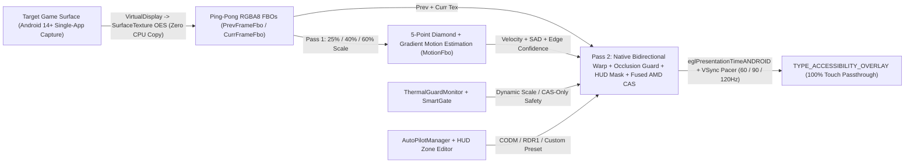

<div align="center">

# Framewise (FrameBoost)

**Real-Time Android GPU Frame Interpolation (30→60 & 60→90/120 FPS) + AMD Contrast Adaptive Sharpening (CAS)**  
**توليد الإطارات على المعالج الرسومي في الوقت الفعلي مع مصفاة توضيح التباين AMD CAS بدون ضبابية**

[-00E676?style=for-the-badge&logo=android&logoColor=white)](https://github.com/omarpromax2021do-droid/FrameBoost)
[](https://github.com/omarpromax2021do-droid/FrameBoost)
[](https://github.com/omarpromax2021do-droid/FrameBoost)
[](https://github.com/omarpromax2021do-droid/FrameBoost/releases/latest)

</div>

---

## English Documentation

### How Framewise Works (Zero-Copy OpenGL ES 3.1 Pipeline)

Framewise intercepts game frames via `MediaProjection` + `VirtualDisplay` directly into an external OpenGL texture (`GL_TEXTURE_EXTERNAL_OES`) with zero CPU `Bitmap` readback, renders motion-compensated intermediate frames directly on the GPU, sharpens every output frame with 5-tap AMD Contrast Adaptive Sharpening (CAS), and displays them on a touch-passthrough `TYPE_ACCESSIBILITY_OVERLAY` window (`FLAG_NOT_TOUCHABLE`) locked via Android Adaptive Refresh Rate (`Surface.setFrameRate`).



### Supported Interpolation & Clarity Modes

| Mode | Target Cadence | Motion Scale | Best Use Case | SmartGate Min Base FPS |
| :--- | :--- | :--- | :--- | :--- |
| **60→120 FPS Competitive** | Alternates real & synthesized frames at 8.33ms VSync | 40% (Balanced) or 60% (Quality) | **Call of Duty Mobile** & fast shooters on 90/120Hz panels | 40 FPS |
| **30→60 FPS Console** | Doubles 30 FPS console-paced gameplay to 60Hz | 25% (Ultra-Light, `<1.2ms` GPU) | **Red Dead Redemption 1** & heavy AAA 3D games | 24 FPS |
| **60Hz Stabilizer + CAS** | Passthrough VSync + 5-tap AMD CAS sharpening | Bypassed (`<0.3ms` overhead) | Legacy 60Hz devices, thermal throttling, low base FPS | Always On |

### Auto-Pilot Game Engine, RAM Optimizer & Thermal Guard

- **Call of Duty Mobile Auto-Profile** (`com.activision.callofduty.shooter`, `com.garena.game.codm`, `com.tencent.tmgp.kr.codm`, `com.vng.codm`):
  - **90/120Hz devices**: Enables `60→120 Competitive`, 40% Balanced flow, `CAS = 0.65`, and locks the **HUD Protection Mask** over center crosshair (`0.44..0.56`), top-left minimap (`0.00..0.22`), and bottom touch controls so the reticle never warps.
  - **60Hz / Legacy Low-RAM devices**: Switches to `30→60 Console` or `60Hz Stabilizer + CAS` (`CAS = 0.70`) for rock-solid smoothness.
- **Red Dead Redemption 1 & Heavy AAA Profile** (`com.netflix.NGP.Kamo`, `com.rockstargames.rdr`, `com.miHoYo.GenshinImpact`):
  - Forces `30→60 Console` (`25%` Ultra-Light motion scale, 24 FPS gate) with strong `CAS = 0.85` to eliminate dynamic-resolution softness without starving the game's 3D engine.
- **Pre-Launch RAM Booster & `GameManager`**: Trims non-essential background cached processes via `ActivityManager.killBackgroundProcesses`, reports real freed MB (`MemoryInfo` delta), and reads Android `GameManager.getGameMode()` (API 31+).
- **Thermal Guard (API 26–37+)**: Uses `PowerManager.OnThermalStatusChangedListener` (API 29+) + battery temperature BroadcastReceiver (`>= 42°C` on API 26–28) to step down GPU load (`60% → 40% → 25% → CAS-Only`) while keeping AMD CAS sharpening active, restoring automatically on cooldown.
- **Visual Split-Screen Benchmark**: Side-by-side live OpenGL ES 3.1 top/bottom comparison (Raw Baseline vs Framewise Optical Flow + AMD CAS) with hardware timings and Markdown/JSON report export.

### Device Compatibility Matrix

| Tier | Criteria | Android Support | Recommended Preset |
| :--- | :--- | :--- | :--- |
| **High Flagship** | OpenGL ES 3.1+, 7GB+ RAM, 120Hz+ panel, `<1.6ms` calibrated shader | Android 8.0 – Android 17+ (API 26–37+) | `60→120 Competitive`, 60% Quality, CAS `0.65` |
| **Mid-Range 120Hz** | OpenGL ES 3.0+, 4–8GB RAM, 90/120Hz panel, `<=4.5ms` pass (e.g. Moto G85 / Adreno 619) | Android 8.0 – Android 17+ (API 26–37+) | `60→120 Competitive` (40% Balanced) or `30→60 Console` (25% RDR1) |
| **Legacy 60Hz** | 60Hz display or `>4.5ms` shader pass | Android 8.0 – Android 17+ (API 26–37+) | `30→60 Console` (25% Ultra-Light) or `60Hz Stabilizer + CAS` |

### Honest Technical Disclaimers

- **Zero Fake Telemetry**: All FPS, frame time, GPU shader pass (`GL_TIME_ELAPSED_EXT` / `glFinish()`), latency, thermal status, and freed RAM metrics are strictly measured from live system APIs.
- **Pipeline Latency**: Optical flow stores 1 prior frame in GPU FBOs, adding ~1 frame of capture buffering latency.
- **Input Frame Stability**: Frame generation works cleanly when the base game holds a steady **25–30+ FPS** (for 30→60 Console Mode) or **45–60+ FPS** (for 60→120 Competitive Mode). Heavy base stuttering cannot be eliminated by post-process interpolation, so **SmartGate** automatically falls back to **CAS-Only** cleanly when base FPS drops.
- **Pre-Android 14 Note**: Single-App `MediaProjection` capture is supported on Android 14+ (API 34+); older Android versions (8–13) capture the whole display surface, so users should minimize Framewise before launching a game.

### Build & Release Guide

```bash
# 1. Debug APK + JVM Unit Tests
./gradlew assembleDebug testDebugUnitTest

# 2. Signed Release APK (configure keystore/frameboost-release.jks in local.properties or env vars)
./gradlew assembleRelease

# 3. SHA-256 verification artifact (used by in-app HTTPS GitHub Updater)
sha256sum app/build/outputs/apk/release/app-release.apk
```

---

## التوثيق باللغة العربية (Arabic Documentation)

<div dir="rtl">

### كيف يعمل Framewise (مسار Zero-Copy على OpenGL ES 3.1)

يعمل تطبيق **Framewise** على التقاط إطارات اللعبة عبر `MediaProjection` مباشرة إلى نسيج رسومي `GL_TEXTURE_EXTERNAL_OES` على المعالج الرسومي (GPU) دون نسخ بطيء إلى المعالج المركزي (CPU)، ثم ينفذ مراحل المعالجة التالية في الوقت الفعلي:
1. **تقدير الحركة المزدوج (`motion_estimation.frag`)**: حساب متجهات الحركة بدقة قابلة للتخصيص (`25%` فائق الخفة، `40%` متوازن، `60%` جودة عالية).
2. **التوليد المانع للأطياف + مصفاة AMD CAS (`frame_synthesis_cas.frag`)**: توليد الإطار الوسيط مع فحص التداخل وحماية مناطق مؤشر التصويب والخريطة والأزرار (`HUD Protection Mask`) وتطبيق **توضيح التباين التكيفي (CAS)** في نفس تمريرة الرسم لإزالة أي ضبابية أو غشاوة.
3. **طبقة تمرير اللمس ومزامنة الشاشة (`FrameBoostOverlayService`)**: عرض الإطارات فوق اللعبة عبر `TYPE_ACCESSIBILITY_OVERLAY` مع حجب صفر للمس (تمرير 100% من اللمسات للعبة) وقفل تردد الشاشة إلى 60/90/120Hz على أندرويد 8.0 حتى أندرويد 17+.

### الأوضاع المدعومة والطيار الآلي (Auto-Pilot)

- **الوضع التنافسي `60→120 FPS`** (مُحسّن لـ **Call of Duty Mobile** على شاشات 90/120Hz): نطاق حركة متوازن `40%`، حدة `CAS 0.65`، وقناع حماية التصويب والخريطة والأزرار.
- **وضع الكونسول `30→60 FPS`** (مُحسّن لـ **Red Dead Redemption 1** وألعاب 3D الثقيلة): نطاق حركة فائق الخفة `25%`، بوابة ذكية عند `24 FPS`، وحدة عالية `CAS 0.85` لإبراز تفاصيل الصورة دون إجهاد محرك اللعبة.
- **مثبت 60Hz + CAS**: للأجهزة الاقتصادية 60Hz أو أثناء ارتفاع الحرارة، يحافظ على سلاسة ثابتة وحدة عالية بأقل استهلاك (`< 0.3ms`).
- **مسرّع الذاكرة قبل التشغيل (`SystemOptimizer`) والحماية الحرارية (`ThermalGuardMonitor`)**: تنظيف العمليات الخلفية غير الضرورية وحساب الذاكرة المحررة بدقة، مع خفض تلقائي لدقة التدفق البصري عند سخونة الجهاز (`>= 42°C` أو `MODERATE`) مع إبقاء توضيح `CAS` مفعّلاً.
- **اختبار الشاشة المقسومة البصري (`Split-Screen Benchmark`)**: مقارنة مباشرة على الشاشة بين المشهد الأصلي بالأعلى ومشهد Framewise + CAS بالأسفل مع تصدير التقارير بصيغتي Markdown و JSON.

### تنويه تقني صادق

- لا يزيّف التطبيق أي قراءات FPS أو أزمنة استجابة؛ كل الأرقام تُقاس مباشرة من مؤقتات النظام وعدادات OpenGL ES الحقيقية.
- يحتفظ محرك توليد الإطارات بإطار واحد سابق لحساب الحركة (يضيف نحو إطار واحد من زمن الاستجابة).
- يعتمد الحصول على أفضل سلاسة على ثبات معدل اللعبة الأساسي عند **25–30+ FPS** لوضع الكونسول، أو **45–60+ FPS** للوضع التنافسي 120Hz.

</div>
